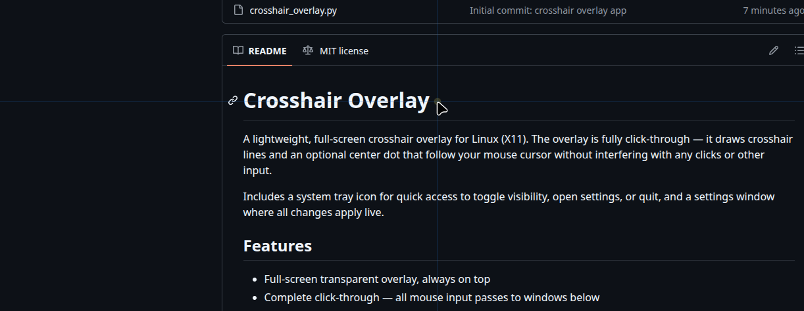
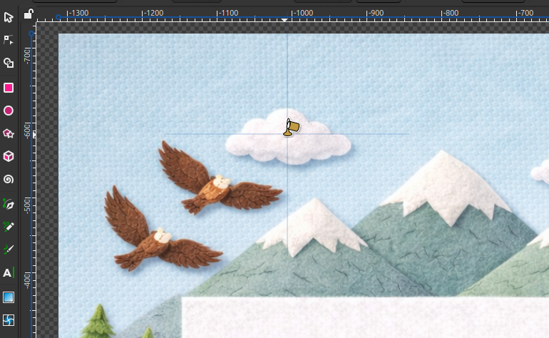
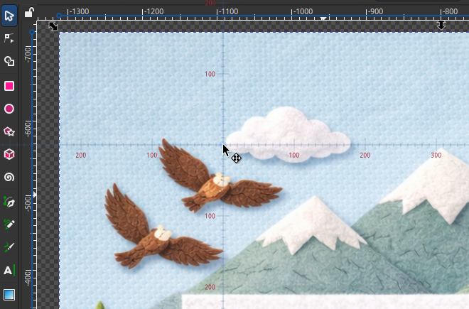
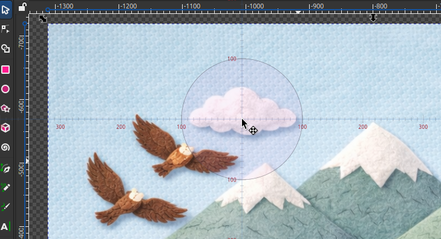
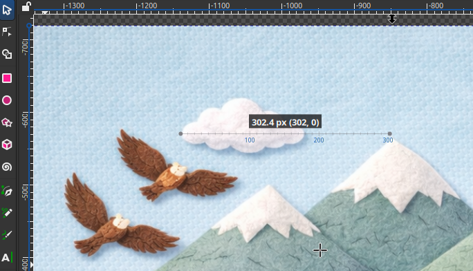

# Crosshair Overlay

A lightweight, full-screen crosshair overlay for **Linux** and **Windows**. The overlay is fully click-through — it draws crosshair lines and an optional center dot that follow your mouse cursor without interfering with any clicks or other input.

Includes a built-in **pixel ruler** with configurable tick marks and distance labels, plus a dedicated **measure mode** for click-and-drag distance measurement between any two points on screen — ideal for graphic design, game development, UI work, or any task that benefits from precise pixel measurements.

A system tray icon provides quick access to toggle visibility, open settings, or quit. All settings apply live and persist across restarts.

## Screenshots

The crosshair overlay in action, showing the crosshair lines and center dot following the cursor:



Using the crosshair with a radius of 170 in Inkscape, making the exact point of the fill tool easily seen:



The built-in ruler with tick marks and distance labels — measure pixel distances directly from your cursor in any application:



The center dot scaled up with a stroke outline, useful for highlighting a precise area or creating a circular reference point:



Measure mode with ruler ticks and Ctrl-snap — click and drag to measure pixel distances between any two points, with signed (x, y) coordinates:



## Features

- Full-screen transparent overlay, always on top
- Complete click-through — all mouse input passes to windows below
- Customizable crosshair line color, width, and opacity
- Full screen or fixed-radius crosshair size
- **Fade out** — lines, ticks, and labels fade from their set opacity to zero between a start and end distance from the center
- Center dot with independent fill and stroke (color, opacity, width), toggleable on/off
- **Pixel ruler** — tick marks along the crosshair lines with configurable spacing and major/minor sizes
- **Distance labels** — pixel-distance readouts at major ticks with customizable color, opacity, and font size
- **Measure mode** — click and drag to measure the distance between any two points on screen
  - Displays total distance in pixels and signed (x, y) offset from the origin (right/up positive)
  - Ruler ticks along the measurement line, reusing the crosshair's tick settings
  - Hold **Ctrl** while dragging to snap the angle to 15° increments (0°, 15°, 30°, 45°, etc.)
  - Press **Escape** to return to crosshair mode
- **Favorites** — save named presets of your crosshair settings and switch between them instantly from the settings window or the tray menu
- **Brightness** — one control that dims or brightens every element together, keeping their relative opacities
- **Keyboard shortcuts** — global shortcuts to raise or lower the brightness and to show or hide the crosshair, configurable in Settings
- **Start at login** — optional autostart on both platforms
- **Uninstall** — remove config files and autostart entries from within the settings window
- All values editable via spin buttons (type exact values or use arrows)
- Live-preview settings window with responsive layout
- System tray icon with toggle, mode switching, settings, favorites, and quit
- Settings persist across restarts
- Runs one copy at a time — on Windows a new launch replaces the running copy, on Linux it exits
- Multi-monitor support

## Platform Support

| | Linux | Windows |
|---|---|---|
| **Overlay** | GTK 3 + Cairo | Win32 API + GDI+ (ctypes) |
| **Settings** | GTK 3 | tkinter (dark theme) |
| **Tray icon** | AppIndicator3 | pystray + Pillow |
| **Config path** | `~/.config/crosshair-overlay/config.json` | `%APPDATA%\crosshair-overlay\config.json` |
| **Favorites** | `~/.config/crosshair-overlay/favorites.json` | `%APPDATA%\crosshair-overlay\favorites.json` |

## Installation

### Linux requirements

The Linux version needs an X11 session and a running compositor, however you install it. Without a compositor the overlay can't be transparent, so the app shows an error and exits.

- **Desktops with built-in compositing:** Cinnamon includes a compositor. Some desktops, including MATE, let you turn compositing off; on MATE it's the software compositing option under Control Center > Windows.
- **Window managers without compositing:** install and run a standalone compositor such as `picom`, then start the app.

Keyboard shortcuts on Linux also need the Keybinder library (`gir1.2-keybinder-3.0` on Debian-based systems). The app runs without it, but the shortcuts are unavailable.

The `.deb` is for Debian-based systems such as Ubuntu and Linux Mint. On other distributions, such as Fedora, install your distribution's equivalent packages and run from source.

### Linux (.deb)

Download `crosshair-overlay_1.1.1_all.deb` from the [latest release](https://github.com/spuddermax/crosshair-overlay/releases/latest) and install:

```bash
sudo dpkg -i crosshair-overlay_1.1.1_all.deb
```

Then launch from your application menu or run `crosshair-overlay` from a terminal.

To uninstall:

```bash
sudo dpkg -r crosshair-overlay
```

### Windows (.exe)

Download `CrosshairOverlay-1.1.1.exe` from the [latest release](https://github.com/spuddermax/crosshair-overlay/releases/latest) and run it — no installation required.

### From source

#### Linux

Requirements: Python 3, GTK 3 (`gir1.2-gtk-3.0`), AppIndicator3 (`gir1.2-appindicator3-0.1`), and optionally Keybinder (`gir1.2-keybinder-3.0`) for keyboard shortcuts, plus the [Linux requirements](#linux-requirements) above. The package names and `apt` command below are for Debian-based systems.

```bash
sudo apt install python3 gir1.2-gtk-3.0 gir1.2-appindicator3-0.1 gir1.2-keybinder-3.0
python3 linux/crosshair_overlay.py
```

Most of these are pre-installed on Linux Mint.

#### Windows

Requirements: Python 3 ([python.org](https://www.python.org/downloads/) — check "Add python.exe to PATH"), pystray, Pillow.

```bash
pip install pystray pillow
python windows\crosshair_overlay.py
```

## Controls

A crosshair will appear on screen following your cursor, and a tray icon will appear in your system tray.

- **Linux:** Left-click the tray icon to open the menu.
- **Windows:** Right-click the tray icon to open the menu.

The tray menu contains:

- **Toggle Crosshair** — show or hide the overlay
- **Mode: Crosshair / Measure** — switch between the cursor-following overlay and click-and-drag distance measurement
- **Settings** — open the settings window to adjust appearance
- **Favorites** — quickly load a saved preset from the tray menu
- **About** — show the running version, where it's running from, and a link to its release notes
- **Quit** — exit the application

### Keyboard shortcuts

These work in any application while the overlay is running:

| Shortcut | Action |
|---|---|
| `Ctrl+Alt+Shift+PageUp` | Brighter (hold to keep going) |
| `Ctrl+Alt+Shift+PageDown` | Dimmer (hold to keep going) |
| `Ctrl+Alt+Shift+Home` | Show or hide the crosshair |

To change one, open **Settings**, click its box under **Brightness & Shortcuts**, and press the new keys. Backspace clears it. Shortcuts need Ctrl, Alt or Super (the Windows key) so they can't clash with typing. If another program or the desktop already uses the keys, Settings says so and the shortcut stays off. Shortcuts used only inside one application can't be detected, and the overlay takes them over while it's running.

The brightness multiplies every element's opacity, from 0 to 2, and **Reset brightness** puts it back to 1. Above 1, an element stops at full opacity.

### Measure mode

Select **Measure** from the tray menu. Click and drag anywhere on screen to draw a measurement line. The label shows the total distance in pixels and the signed (x, y) offset from the click origin (right and up are positive). If tick marks are enabled, ruler ticks appear along the measurement line using the same settings as the crosshair ruler.

Hold **Ctrl** while dragging to snap the line angle to the nearest 15° increment. Press **Escape** to return to crosshair mode.

To stop the app from the terminal, press `Ctrl+C`.

## Configuration

Settings are stored in a JSON config file (see platform table above) and are created automatically on first run with sensible defaults:

| Setting | Default | Description |
|---|---|---|
| `line_color` | `[0.9, 0.9, 0.9]` | Crosshair line RGB (0.0 - 1.0) |
| `line_width` | `1.0` | Line thickness in pixels |
| `line_opacity` | `0.35` | Line opacity (0.0 - 1.0) |
| `crosshair_fullscreen` | `true` | Lines span the full screen |
| `crosshair_radius` | `100` | Line radius from center in pixels (when not fullscreen) |
| `fade_enabled` | `false` | Fade the crosshair lines, ticks, and labels with distance from the center |
| `fade_start` | `100` | Distance from center in pixels where fading begins |
| `fade_end` | `300` | Distance from center in pixels where opacity reaches zero (if not past `fade_start`, the crosshair simply cuts off at `fade_start`) |
| `dot_enabled` | `true` | Show center dot |
| `dot_radius` | `3` | Dot radius in pixels (1 - 2000) |
| `dot_fill_color` | `[1.0, 0.3, 0.3]` | Dot fill RGB (0.0 - 1.0) |
| `dot_fill_opacity` | `0.6` | Dot fill opacity (0.0 - 1.0) |
| `dot_stroke_color` | `[1.0, 1.0, 1.0]` | Dot stroke RGB (0.0 - 1.0) |
| `dot_stroke_opacity` | `0.0` | Dot stroke opacity (0.0 - 1.0) |
| `dot_stroke_width` | `1.0` | Dot stroke width in pixels |
| `tick_enabled` | `false` | Show ruler tick marks along crosshair lines |
| `tick_color` | `[0.9, 0.9, 0.9]` | Tick mark RGB (0.0 - 1.0) |
| `tick_opacity` | `0.3` | Tick mark opacity (0.0 - 1.0) |
| `tick_spacing` | `10` | Pixels between minor ticks (5 - 200) |
| `tick_major_every` | `5` | Every Nth tick is a major (longer) tick |
| `tick_minor_length` | `3.0` | Minor tick length in pixels (each side of line) |
| `tick_major_length` | `6.0` | Major tick length in pixels (each side of line) |
| `tick_labels` | `false` | Show pixel-distance labels at major ticks |
| `tick_label_color` | `[0.9, 0.9, 0.9]` | Label text RGB (0.0 - 1.0) |
| `tick_label_opacity` | `0.5` | Label text opacity (0.0 - 1.0) |
| `tick_label_size` | `9.0` | Label font size in pixels (6 - 24) |
| `brightness` | `1.0` | Multiplies every element's opacity (0.0 - 2.0); not saved in favorites |
| `shortcut_brightness_up` | `"Ctrl+Alt+Shift+PageUp"` | Shortcut to raise the brightness; `""` turns it off |
| `shortcut_brightness_down` | `"Ctrl+Alt+Shift+PageDown"` | Shortcut to lower the brightness; `""` turns it off |
| `shortcut_toggle` | `"Ctrl+Alt+Shift+Home"` | Shortcut to show or hide the crosshair; `""` turns it off |

## Notes

The crosshair overlay will appear in screenshots only if your screenshot tool is set to capture the cursor.

## License

[MIT](LICENSE)
